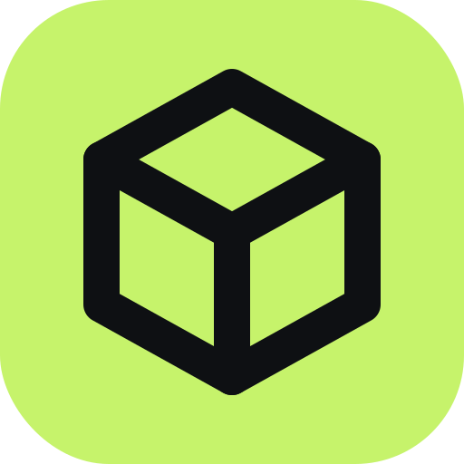

# Docker Manager

<br clear="left">

A small web page, running on each of your servers, that shows whether your Docker containers are on the newest images – and lets you update them with one click.

- [What it does](#what-it-does)
- [How it decides there's an update](#how-it-decides-theres-an-update)
- [Security](#security)
- [Set up the Azure app registration](#set-up-the-azure-app-registration)
- [Set up Azure Communication Services email](#set-up-azure-communication-services-email)
- [Install on a server](#install-on-a-server)
- [Settings](#settings)
- [Configuration reference](#configuration-reference)
- [Private images](#private-images)
- [Updating the dashboard itself](#updating-the-dashboard-itself)
- [Docker Hub limits](#docker-hub-limits)
- [First run checklist](#first-run-checklist)
- [Troubleshooting](#troubleshooting)

## What it does

You install one copy of the dashboard on **each** server. It only sees the containers on that server.

- Lists every container, grouped by compose project, with the image it runs and the newest one available.
- Checks automatically every 6 hours, and whenever you press **Check now**.
- Updates a container with one click and shows the live output while it runs. Every update is kept in **History** (who, when, what, result and the full log).
- Updates Mailcow using Mailcow's own `update.sh`, exactly as you would by hand.
- Has a **Settings** page for most options, so you don't need to edit files and restart. Changes are kept in **History**.
- Sends a weekly email (Monday 08:00 by default) listing what needs updating. If everything is up to date it still emails, so silence never means "broken".
- Sign-in is with your Microsoft 365 / Entra ID account. There are no passwords to manage in the dashboard itself.

It never updates anything on its own – every update is a click by a signed-in person.

## How it decides there's an update

For each container it checks two things:

**Newer build** – the tag you use (for example `nginx:latest` or `postgres:16`) now points to a newer image in the registry than the one your container is running. The button runs `docker compose pull` and `docker compose up -d --no-deps` for that service only (the services it depends on are left alone). If several services in the project use the same image, there's also **Update whole project** (not offered for the dashboard's own project). A stopped container shows **Stopped – updating will start it**.

If the newer image has already been pulled but the container was never recreated, it shows **Pulled – not recreated**; the same button recreates it on the newer image.

**Newer version** – the tag is a version number (for example `postgres:16.2` or `1.25.4-alpine`) and a higher version exists. Only tags that look the same are compared – same `v` prefix or not, same ending (`-alpine`, `-bookworm` and so on) and the same number of parts – and test releases (`rc`, `beta`, `alpha`, `dev`, `nightly`, `preview`, `snapshot`) are ignored.

- **Minor or patch** (for example `16.2` → `16.4`): you get a button. You are shown exactly what will change in the compose file first. The file is backed up to the dashboard's `data` folder (`data/backups/<project>/<file>.<date-time>` next to the dashboard's compose file), the tag is changed on that one line only, and the service is pulled and restarted. It then has to stay running (and healthy, if it has a healthcheck) without restarting for 20 seconds, within `HEALTH_TIMEOUT_SECONDS`. If it doesn't, the backup is put back and the old version restarted.
- **Major** (for example `16` → `17`): shown with a warning that it may need a data migration. There's no button – do these by hand.

If the version comes from a variable (for example `image: postgres:${PG_VERSION}`), the dashboard won't edit it and asks you to update by hand.

Updates run `docker compose` the way you would by hand in the project's folder: `${PWD}` in a compose file is the project folder, and if you started the project with `--env-file`, the same files are passed again (they must be visible to the dashboard at the same path – anything under `/docker` is).

**Mailcow** – all Mailcow containers are shown as one **Mailcow** row. The dashboard runs Mailcow's own `./update.sh --check` on the server to see whether Mailcow has an update. **Update Mailcow** runs `./update.sh --force` – the same as running `./update.sh` by hand, without the questions.

Some containers show **Not checkable** – for example images you built yourself, or images pinned by digest (`image@sha256:…`). Containers not started by `docker compose` are shown but can't be updated here.

## Security

Please read this before installing.

- **The dashboard can control Docker on the server.** It needs the Docker socket (`/var/run/docker.sock`) to see and update containers, and access to that socket is the same as root access to the server. This is true on every server, not just the ones that run Mailcow.
- **The Entra sign-in is the protection.** Every page needs a signed-in account – there is no default password, setup mode or way in without signing in. That is why the [Assignment required](#5-only-let-assigned-people-sign-in) step below matters so much.
- **On a server that runs Mailcow** the dashboard also runs with `pid: host` and `privileged: true`, so it can run Mailcow's `update.sh` directly on the server, exactly as you would by hand as root. Because the Docker socket already gives root-level control, these options remove friction rather than adding a new kind of risk. Don't think of the other servers as much safer – on all of them, the sign-in is what protects you.
- The dashboard is only reachable through your reverse proxy (Caddy or Traefik). The examples have no `ports:` section on purpose – please keep it that way.
- Keep your `.env` file (secrets) private.
- Secrets you save on the Settings page are encrypted – see [Settings](#settings) for what that does and doesn't protect.

## Set up the Azure app registration

You need one app registration. You can use the same one for all your servers – just add a redirect URI for each.

### 1. Register the app

1. Sign in to the [Microsoft Entra admin centre](https://entra.microsoft.com).
2. Go to **Identity → Applications → App registrations → New registration**.
3. **Name:** `Docker Manager` (anything you like).
4. **Supported account types:** **Accounts in this organisational directory only (Single tenant)**.
5. **Redirect URI:** choose **Web**, and enter `https://<your-host>/auth/callback` – for example `https://updates.server1.example.com/auth/callback`.
6. Click **Register**.

### 2. Copy the IDs

On the app's **Overview** page, copy:

- **Application (client) ID** → `AZURE_CLIENT_ID`
- **Directory (tenant) ID** → `AZURE_TENANT_ID` (the long code like `1a2b3c4d-…` – not your domain name)

### 3. Add each server's address

For each extra server, go to **Authentication → Web → Redirect URIs → Add URI** and add `https://<that server's host>/auth/callback`. Click **Save**.

### 4. Create a client secret

1. Go to **Certificates & secrets → Client secrets → New client secret**.
2. Give it a description and choose how long it lasts (put a reminder in your calendar to renew it before it expires).
3. Click **Add**, then copy the **Value** straight away (it's only shown once) → `AZURE_CLIENT_SECRET`. Don't copy the "Secret ID" – that's a different thing.

### 5. Only let assigned people sign in

> **Important:** without this step, **anyone in your Microsoft 365 organisation could sign in** and control Docker on your servers.

1. Go to **Identity → Applications → Enterprise applications** and open the app with the same name.
2. Go to **Properties**, set **Assignment required?** to **Yes**, and click **Save**.
3. Go to **Users and groups → Add user/group**, choose yourself (and anyone else who should have access), and click **Assign**.

### 6. Optional: extra restrictions

These are a second safety net on top of assignment. You don't need them.

- **`ALLOWED_EMAILS`** – a comma-separated list of people allowed in. It is matched against their **sign-in name** (the user principal name, shown as "User principal name" in Entra), **not** their email address. Usually these are the same, but if someone signs in as `jo@company.onmicrosoft.com` and has the mail address `jo@company.co.uk`, you must list `jo@company.onmicrosoft.com`.
- **`ALLOWED_GROUP_ID`** – the **Object ID** of an Entra group whose members are allowed in. This needs the app to send group membership in the sign-in token: in the app registration, go to **Token configuration → Add groups claim**, tick **Security groups** (or **Groups assigned to the application**), and **Save**. Without a groups claim nobody can sign in when this is set.

Sign-in fails closed: if a restriction is set and the person doesn't meet it, they are refused.

## Set up Azure Communication Services email

This is only needed for the weekly email. Skip it if you don't want emails. You can enter the values below either in your `.env` file or on the dashboard's [Settings page](#settings).

1. In the [Azure portal](https://portal.azure.com), create an **Email Communication Services** resource (search for "Email Communication Services" → **Create**). Choose a resource group and a data location (for example **UK** or **Europe**).
2. Open it and go to **Provision domains**. Either:
   - **Add an Azure managed domain** – quickest; it gives you an address like `DoNotReply@xxxx.azurecomm.net`, or
   - **Add a custom domain** (for example `example.com`), then add the TXT, SPF and DKIM records it shows you at your DNS provider, and wait until every record shows **Verified**.
3. Create a **Communication Services** resource (search for "Communication Services" → **Create**), in the same data location.
4. Open the Communication Services resource and go to **Email → Domains → Connect domain**, and pick the domain from step 2.
5. Check the sender address: in the Email Communication Services resource, open the domain → **MailFrom addresses**. The default is `DoNotReply@<your domain>`. This is the sender (`DIGEST_FROM`).
6. In the Communication Services resource, go to **Settings → Keys** and copy the **Connection string** → `ACS_CONNECTION_STRING`. Enter it on the Settings page (it is encrypted when saved), or put it in your `.env` file.
7. Put the people who should get the email in the recipients (`DIGEST_TO`, comma-separated).

Use **Send test email** on the Settings page to check it works, or **Send digest now** on the dashboard.

## Install on a server

Before you start you need: Docker with the Compose plugin, a reverse proxy (Caddy or Traefik) already running in Docker, and a DNS name for the dashboard pointing at the server (for example `updates.server1.example.com`).

Pick the example that fits the server:

| Server | Example |
| --- | --- |
| Uses Caddy | [`examples/caddy/compose.yml`](examples/caddy/compose.yml) + [`examples/caddy/Caddyfile`](examples/caddy/Caddyfile) |
| Uses Traefik | [`examples/traefik/compose.yml`](examples/traefik/compose.yml) |

Mailcow isn't a separate kind of server – it runs alongside Caddy or Traefik. If the server runs Mailcow, use the example for its proxy and uncomment the three lines marked `[Mailcow]` in it.

### Steps

1. Find the name of your reverse proxy's Docker network:

   ```sh
   docker network ls
   ```

   The examples assume it's called `proxy`. If yours is different, change `proxy` in the compose file (and, for Traefik, in the `traefik.docker.network` label).

2. Make a folder for the dashboard and go into it. Putting it under `/docker` means it updates itself correctly and shows in hPanel like your other projects:

   ```sh
   mkdir -p /docker/docker-manager
   cd /docker/docker-manager
   ```

3. Copy the right example into this folder as `compose.yml`, and copy [`examples/.env.example`](examples/.env.example) as `.env`.

   Everything for the dashboard then lives in this folder: `compose.yml`, `.env`, and a `data` folder that is created on first start and holds the database and compose-file backups. Back up this one folder.

4. Edit `compose.yml`: set `PUBLIC_URL`. For Traefik, also set the host name, entry point and certificate resolver in the labels. If the server runs Mailcow, uncomment the lines marked `[Mailcow]`.

5. Edit `.env`: fill in `AZURE_TENANT_ID`, `AZURE_CLIENT_ID` and the client secret. The email settings can wait: you can set them on the [Settings page](#settings) after signing in. Then make the file private:

   ```sh
   chmod 600 .env
   ```

6. **Caddy servers:** add the block from the example `Caddyfile` to your Caddy configuration, with your host name, and reload Caddy.

7. Start it:

   ```sh
   docker compose up -d
   docker compose logs -f
   ```

   Press Ctrl+C to stop watching the logs (the dashboard keeps running).

8. Open `PUBLIC_URL` in your browser and sign in. Then open **Settings** to set the server name, email and anything else.

> **Note:** `PUBLIC_URL` must match the redirect URI in Azure exactly (same host, `https`), or sign-in fails.

## Settings

Open **Settings** from the top of the dashboard. Most options can be changed there, with no file editing or restart:

- **General** – server name and time zone.
- **Checking** – how often to check for updates, how long a version update waits for the service to come up healthy, and the Mailcow folder.
- **Email** – the Azure Communication Services connection string, sender, recipients, the schedule, and whether to email when everything is up to date. **Send test email** sends a message straight away so you can check it works.
- **Registry logins** – logins for private images (see [Private images](#private-images)). Each one is checked against the registry before it is saved.

Each section is saved on its own. If one value in a section is invalid (for example a schedule that isn't valid, or an unknown time zone) nothing in that section is saved, and the form shows the problem with your other entries still in place. Changes appear in **History → Changes** – the old and new values, but never secrets.

**Environment variables still win.** Every setting that could be set with an environment variable in 0.1 still can, and an environment variable always beats the Settings page. A field set that way is shown read-only as "Set by the server's environment (`NAME`)". To manage it on the page instead, remove the variable from your compose file or `.env` and run `docker compose up -d`.

**Secrets are encrypted.** The connection string and registry passwords or tokens that you save on the page are encrypted in the database, and are never shown again or sent back to your browser. To keep one as it is, leave its field blank when you save. The key is created automatically the first time the dashboard starts, as `/data/secret.key` (in your `data` folder).

What this does and doesn't do:

- It protects a copy of the database file on its own – for example one that ends up in a backup or is sent to someone for help.
- It does **not** protect against someone who has all of the `data` folder, because the key is in it.
- For stronger protection, keep the key somewhere else: put `secret.key` in a separate folder, mount that folder in the container, and point `SECRET_KEY_FILE` at it (for example `SECRET_KEY_FILE: "/run/dm-key/secret.key"`). Then back up the database and the key separately.
- Back the key up. If the key file is missing, a new one is created when the dashboard starts, so anything saved with the old key can't be read: the dashboard still starts, the fields say "The saved value can't be read – enter it again", and you enter them again. If the file is there but can't be used (it is not 32 bytes long, or can't be read), the dashboard still starts and logs one error, but it never overwrites the file; saved secrets can't be read and new ones can't be saved until you restore the original key or fix the file.
- The folder for `SECRET_KEY_FILE` must be writable by the dashboard. When moving the key there from the default place, **move the existing `secret.key` into that folder first** – if you only set the variable, a new key is created and the secrets you saved can no longer be read.

**Upgrading from 0.1.** If you copy the new example compose file over your old one, the `ACS_CONNECTION_STRING`, `DIGEST_FROM` and `DIGEST_TO` lines (and `DIGEST_SCHEDULE`, `DIGEST_WHEN_NONE`) that 0.1 passed through are dropped. Either keep those lines in your compose file, or enter the email settings on the Settings page. A variable that is set but empty (for example `ACS_CONNECTION_STRING=` to switch email off) no longer locks the Email section; only a variable with a value does.

Everything the dashboard needs to start – `PUBLIC_URL`, the `AZURE_*` values, `DATA_DIR`, `COMPOSE_ROOT` and `SECRET_KEY_FILE` – is still set with environment variables. The Entra values move to the Settings page in a later release.

## Configuration reference

Settings can be environment variables in the compose file, and many can also be changed on the [Settings page](#settings) – the **Settings page** column shows which. The Entra app registration and its secret go in `.env` next to the compose file; the examples read them from there. If a variable is set, it wins over the Settings page and the field shows as locked there.

| Variable | Required | Default | Settings page | What it's for |
| --- | --- | --- | --- | --- |
| `SERVER_NAME` | No | `Docker Manager` | Yes | Name shown on the page and in the email |
| `PUBLIC_URL` | No | – | Yes | The dashboard's address, for example `https://updates.server1.example.com` |
| `AZURE_TENANT_ID` | No | – | Yes | Directory (tenant) ID – the long code, not your domain name |
| `AZURE_CLIENT_ID` | No | – | Yes | Application (client) ID |
| `AZURE_CLIENT_SECRET` | No | – | Yes | Client secret **Value** (keep in `.env`) |
| `SESSION_SECRET` | No | – | – | No longer needed – ignored if set, so 0.1 `.env` files still work |
| `ALLOWED_EMAILS` | No | – | No | Comma-separated **sign-in names** (UPNs) allowed in |
| `ALLOWED_GROUP_ID` | No | – | No | Object ID of an Entra group allowed in; needs a groups claim |
| `CHECK_INTERVAL_HOURS` | No | `6` | Yes | How often to check for updates |
| `COMPOSE_ROOT` | No | `/docker` | No | Where your compose projects live. Must be mounted at the same path |
| `MAILCOW_DIR` | No | `/opt/mailcow-dockerized` | Yes | Mailcow's folder, mounted at the same path. If Mailcow runs on the server but the folder isn't mounted, the Mailcow row says so |
| `ACS_CONNECTION_STRING` | No | – | Yes | Azure Communication Services connection string (keep in `.env`). Email is off without it |
| `DIGEST_FROM` | No | – | Yes | Sender address set up in Azure Communication Services |
| `DIGEST_TO` | No | – | Yes | Comma-separated recipients |
| `DIGEST_SCHEDULE` | No | `0 8 * * MON` | Yes | When the email is sent: minute, hour, day of month, month, day of week. Use day names for the weekday (`MON`, `MON-FRI`, `SAT,SUN`); numbers work as in cron (`0` or `7` = Sunday, `1` = Monday) |
| `DIGEST_WHEN_NONE` | No | `true` | Yes | Still email when everything is up to date. When `false`, the email is still sent if something couldn't be checked |
| `TZ` | No | `Europe/London` | Yes | Time zone for the schedule and the times shown |
| `HEALTH_TIMEOUT_SECONDS` | No | `300` | Yes | How long a version update waits for the service to come up healthy before rolling back. It must stay running, without restarting, for 20 seconds |
| `REGISTRY_AUTH_FILE` | No | – | Logins can be added there instead | Path to a mounted Docker `config.json` with registry logins, for private images. Used for checks, and – when the file is named `config.json` – for pulls too. See [Private images](#private-images) |
| `LOCAL_SIGN_IN` | No | `true` | Yes | Allow local accounts (email and password kept on this server) |
| `HIDE_LOCAL_FOR_NON_ADMINS` | No | `false` | Yes | Show local sign-in only behind an "Admin sign-in" link |
| `REQUIRE_TOTP_ADMINS` | No | `true` | Yes | Require two-step sign-in for local Admin accounts |
| `DEFAULT_ROLE` | No | `viewer` | Yes | Role given to new Microsoft sign-ins: `pending`, `viewer` or `operator` |
| `DATA_DIR` | No | `/data` | No | Where the database and backups are kept inside the container. Leave as it is; the examples map it to the `data` folder next to the compose file |
| `SECRET_KEY_FILE` | No | `<DATA_DIR>/secret.key` | No | Where the key that encrypts saved secrets is kept. Created on first start; leave as it is |

The email is only sent when the connection string, sender and recipients are all set – by `ACS_CONNECTION_STRING`, `DIGEST_FROM` and `DIGEST_TO`, or on the Settings page.

`SECRET_KEY_FILE`, `DATA_DIR` and `COMPOSE_ROOT` are only ever set with environment variables.

## Private images

For images in a private registry (for example a private package on `ghcr.io`), add a login for it on the dashboard's **Settings** page, under **Registry logins**.

1. Create a **read-only token** at the registry rather than using an account password. For GitHub, use a personal access token with only the `read:packages` permission. Docker Hub has read-only access tokens too.
2. On **Settings → Registry logins**, enter the registry host (for example `ghcr.io`), the username and the token, and save. The dashboard checks the login against the registry first, and doesn't save it if it is refused.
3. Press **Check now**.

Logins saved this way are encrypted (see [Settings](#settings)) and handed to Docker by a small credential helper when it needs them. They are never written to a file in plain text. They are used both to check the image and to pull it when you update. A Docker Hub login also raises Docker Hub's limits (see [Docker Hub limits](#docker-hub-limits)).

### Using `REGISTRY_AUTH_FILE` instead

This still works exactly as before, and the logins in the file keep working alongside any you add on the Settings page. But the file is your own plain-text `config.json`, so moving those logins to the Settings page is recommended.

1. Log in on the server as root (with a read-only token):

   ```sh
   docker login ghcr.io
   ```

2. In the dashboard's `compose.yml`, add the setting and mount the folder (read-only):

   ```yaml
       environment:
         REGISTRY_AUTH_FILE: "/run/docker-auth/config.json"
       volumes:
         - /root/.docker:/run/docker-auth:ro
   ```

   Mount the folder, not just `config.json`: `docker login` replaces the file, and a mounted single file would go on showing the old one.

3. Run `docker compose up -d`, then press **Check now**.

The login must be stored in `config.json` itself. If `docker login` says it used a credential helper (`credsStore`), the dashboard can't read it.

## Updating the dashboard itself

The dashboard checks its own image too, and shows it in the row marked **This dashboard**. Click **Update dashboard**: it starts a short-lived helper container that pulls the new image and restarts the dashboard. The helper's output appears in the job's log. The page will be unavailable for a few seconds; refresh it after a moment.

- After the restart, the job in **History** says **Dashboard restarted – self-update applied**.
- If there was nothing new to pull, the dashboard isn't restarted and the job says **Already up to date – nothing to restart**.
- If the helper fails, the job fails and its log shows the helper's output.

You can also do it by hand:

```sh
cd /docker/docker-manager
docker compose pull
docker compose up -d
```

**For the repository owner:** the image is built by GitHub Actions on every push to `main`/`master` (tagged `latest`) and on version tags like `v1.2.0`. The first time it's published, go to the `dowouk` organisation on GitHub → **Packages → docker-manager → Package settings** and set the visibility to **Public**, so the servers can pull it without signing in.

## Docker Hub limits

You don't need a Docker Hub account – everything works anonymously.

- Checking for a newer build uses `HEAD` requests, which Docker Hub doesn't count towards its pull limit.
- Lists of version tags are cached for 24 hours. Only the newest 1,000 tags of an image are read (Docker Hub doesn't give more without an account), which is plenty for finding newer versions. If a tag list can't be read, the dashboard waits 15 minutes before asking again, and the email lists the image under **Couldn't check**.
- **Updates are real pulls** and do count towards Docker Hub's anonymous limit for your server's IP address. Normal use is well within it.

If the limit is reached, the update stops with the message **"Docker Hub rate limit reached – try again later"**. Nothing is broken – wait a few hours and try again.

## First run checklist

- [ ] You can sign in, and the page shows this server's name.
- [ ] A colleague who is **not** assigned to the app is refused (or try a test account) – this proves **Assignment required** is on.
- [ ] Your compose projects appear grouped by project, not under "Other".
- [ ] None of your `/docker` projects say **Project files not mounted**.
- [ ] Servers that run Mailcow: there is a **Mailcow** row with a version and no error.
- [ ] **Send test email** on the Settings page (or **Send digest now**) delivers an email, if you set up email.
- [ ] Upgrading from 0.1: everyone is asked to sign in again once. That is expected.
- [ ] On your phone: try the version preview dialog, the live log while an update runs, and the **Show only updates** filter.
- [ ] **hPanel check** – after the first minor/patch update the dashboard does, open that project in hPanel's Docker Manager and confirm it shows the new tag. If hPanel puts the old tag back, stop using the dashboard's version-update button for that project and update it in hPanel instead.

## Troubleshooting

**"AADSTS50011: The redirect URI … does not match"** – the redirect URI in the app registration doesn't exactly match `PUBLIC_URL` + `/auth/callback`. Check the spelling, `https`, and that there's no trailing `/`. Add it under **Authentication → Web → Redirect URIs**.

**"AADSTS50105: … not assigned to a role for the application"** – Assignment required is on (good) but this person isn't assigned. Add them in **Enterprise applications → the app → Users and groups**.

**Sign-in goes round in a loop, or you're refused after signing in** – check that `PUBLIC_URL` starts with `https://` and matches the address in your browser, that `AZURE_TENANT_ID` is the Directory (tenant) ID (not a domain name), and that `ALLOWED_EMAILS` uses sign-in names and `ALLOWED_GROUP_ID` has a groups claim, if you set them.

**"Project files not mounted"** – the project's folder isn't visible inside the dashboard. Projects under `/docker` are covered by the `/docker:/docker` mount. For a project elsewhere, add a mount for its folder at the **same path** (for example `- /opt/myapp:/opt/myapp`) and run `docker compose up -d` again.

**"Docker Hub rate limit reached – try again later"** – see [Docker Hub limits](#docker-hub-limits). Wait and try again.

**"Another update is running – try again when it finishes"** – only one update runs at a time on each server. Wait for the current one to finish (see **History**).

**"Version set by variable – update by hand"** – the image tag in the compose file uses `${…}`. Change the variable yourself (often in the project's `.env`), then run `docker compose up -d` in that project.

**"Project uses an env file that isn't mounted – update by hand"** – the project was started with `--env-file` pointing at a file the dashboard can't see. Mount it at the **same path** (or move it under `/docker`), or update that project by hand.

**"Mailcow folder not mounted (MAILCOW_DIR=…)"** – Mailcow is running but the dashboard can't see its folder. Uncomment the `[Mailcow]` mount (`/opt/mailcow-dockerized:/opt/mailcow-dockerized`) in your compose file, or set `MAILCOW_DIR` to where Mailcow really is.

**Mailcow update fails with local changes or merge conflicts** – the dashboard never tries to fix this. Log in to the server, go to `/opt/mailcow-dockerized`, and sort it out by hand as you would normally (`git status` shows what changed).

**The page shows "502 Bad Gateway"** – the proxy can't reach the dashboard. Check `docker compose logs` for errors (a missing required setting is reported there by name), and that the dashboard and the proxy share the network named in the compose file.

**No email arrives** – press **Send test email** on the Settings page and read the message. This is the way to check email: for safety, a failed send is logged with the type of error only, never its text (which could contain your connection string), so the logs say little. Check that the domain is connected to the Communication Services resource, and that the sender (`DIGEST_FROM`) is one of its MailFrom addresses. Look in junk mail.

**Everyone was signed out after upgrading to 0.2** – expected, and it happens once. Sessions are now kept on the server instead of in a signed cookie, so old cookies are no longer recognised. Just sign in again. `SESSION_SECRET` is no longer needed and is ignored if it is still set.

**A field on the Settings page is read-only and says "Set by the server's environment"** – that setting is also set as an environment variable (in your compose file or `.env`), and the variable always wins. Remove it there and run `docker compose up -d` to manage it on the page.

**"The saved value can't be read – enter it again"** – the key that encrypts saved secrets (`/data/secret.key`, or `SECRET_KEY_FILE`) is missing or has been replaced. The dashboard still runs; enter the secret again and save. Restore the original key file if you have it.
